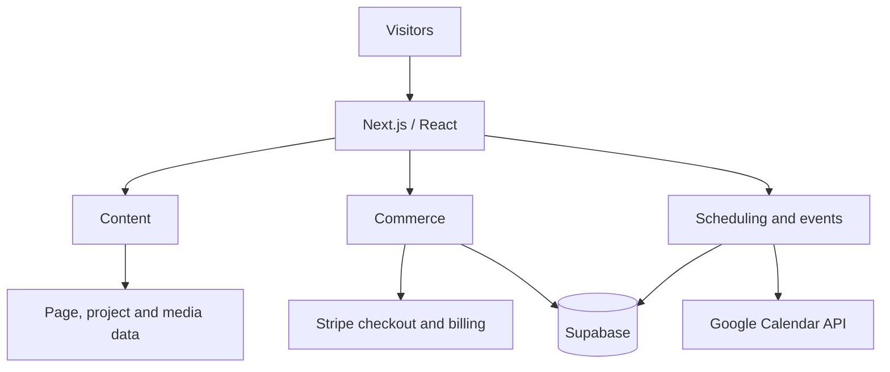

# Architecture

One application, three cohesive modules. Keep external APIs behind server-only adapters. UI components should be reusable across the website. Host-specific code stays isolated so deployment can move.

No live external integrations have been configured. Defer schemas and paid services until actual workflows are confirmed.
