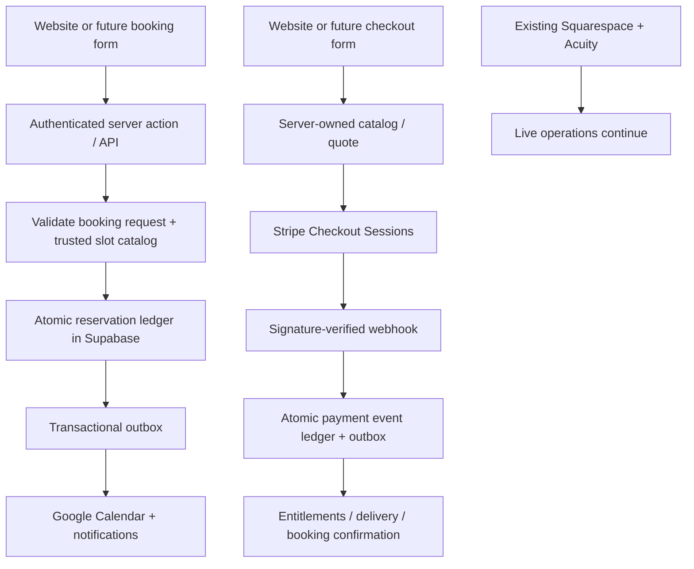

# EmpressVR: booking and commerce foundation (phase 2)

**Status:** Domain logic and contracts implemented; persistence, authentication and external providers remain unconnected. The Squarespace site and Acuity checkout are still the only active booking and payment systems. No Supabase project or Stripe sandbox has been configured or charged.

## Boundaries

The domain logic lives in `src/features/scheduling/domain.ts`, `src/features/commerce/checkout.ts`, and `src/features/commerce/payment-state.ts`. They have zero provider imports and can be reused with later backend adapters. Only future server-side code may use the provider ports. There is currently no operational booking, checkout, webhook, database adapter or replacement UI.

## Booking contracts

A slot must be live, open, future-dated, time-zone aware and matched to its offering. A hold request supplies an opaque attendee reference, seat count and unique idempotency key. Its seat count is checked against trusted per-slot limits. `BookingStore.reserveAtomically` must enforce the following **in one transaction**: unique idempotency keys with payload conflict detection; serialized capacity/count check covering confirmed seats and unexpired holds; an inserted hold or no change at all. A Google free/busy read cannot replace this transaction. Hold expiry is capped to the event start. Only authorized server code may confirm/cancel/expire a booking. Confirmation of a paid booking requires matching settled-order evidence from the trusted ledger. Expiry needs a reliable cleanup job or query-time exclusion and concurrency tests against the actual database.

Calendar syncing, reschedules, client notices and capacity release must be retriable and auditable. Choose whether each source offering represents a class seat, appointment, or informational event before importing into the live schedule. The seven captured public events are archived, not an availability source.

## Checkout and payment contracts

Checkout quotes are computed from the trusted product, campaign or approved membership plan catalog. Client inputs can select IDs, quantities and allowable donation amounts/cadences; they cannot set prices, sold-out status, currency, membership fees or entitlement. Currencies and amounts use integer minor units. A quote is **not** a final payable total: tax/fees and current pricing require server-side revalidation when building a real Stripe Checkout Session.

Stripe-hosted Checkout and Billing should handle one-time and recurring payments; final order state must be driven by **signature-verified** webhooks, including delayed-method success/failure events. The authenticated provider session and original order amount/currency must match. The future ledger must commit the unique event ID, valid state transition and outbox fulfillment task together. Duplicate webhook deliveries must not send duplicate digital goods, grant membership or confirm bookings twice. A paid checkout is not automatically an approved co-operative membership. Recurring contributions and co-op membership subscriptions require additional lifecycle, dispute, refund and reconciliation policies. Purchased downloads must be stored privately with authorized delivery.

## Unresolved business decisions and external dependencies

- Confirm active classes, duration, capacity, IANA time zones, booking cutoffs, rescheduling and refund policies, and who may book/cancel.
- Confirm live products/stock, donation destinations, co-op admission process and the current £1 joining fee / £13–£52 quarterly tier options from the customer, rather than automatically publishing historical prices.
- Confirm ownership and migration plan for the Stripe merchant, Acuity/Google Calendar and legacy recurring subscriptions, plus tax registrations before Stripe Tax configuration.
- Choose production hosting that supports authenticated server routes and webhooks. GitHub Pages is a static **preview** and cannot process paid requests.
- Implement authentication, server-only adapters, authorization and Supabase RLS, event ledger, transactional outboxes, end-to-end test-mode payments, privacy/legal updates and reconciliation before any production cutover.

## Acceptance evidence and safety scope

Run `npm run lint`, `npm run typecheck`, `npm run test`, `npm run build`, and the Playwright suite in CI. The domain test fixtures are never imported by runtime code. No anonymous create-booking, checkout, webhook or payment endpoints are exposed. Do not merge this foundation into the live business site without a separate operational launch gate. No changes to the existing Squarespace DNS, products, payments or bookings.

**ASVS:** 2.1.1–2.1.3 (document inputs and limits), 2.2.1–2.2.3 (validate trusted business rules), 2.3.1–2.3.4 (state sequence, bounded business flows, transactional state and capacity locking). See the publisher-authored OWASP references in `.cursor/skills/security-guidance/data/asvs/`.
